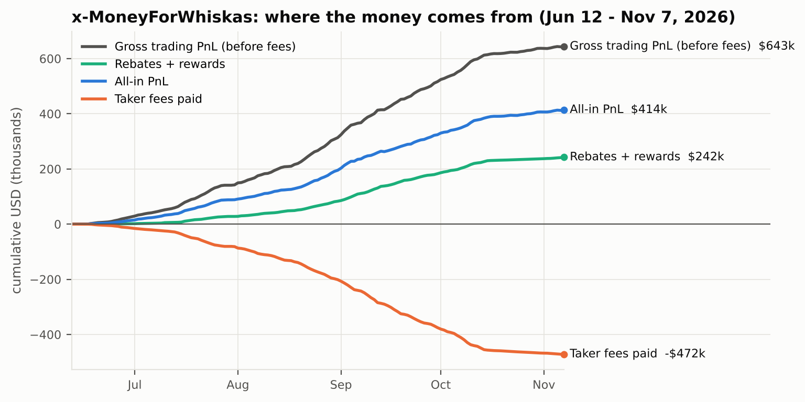
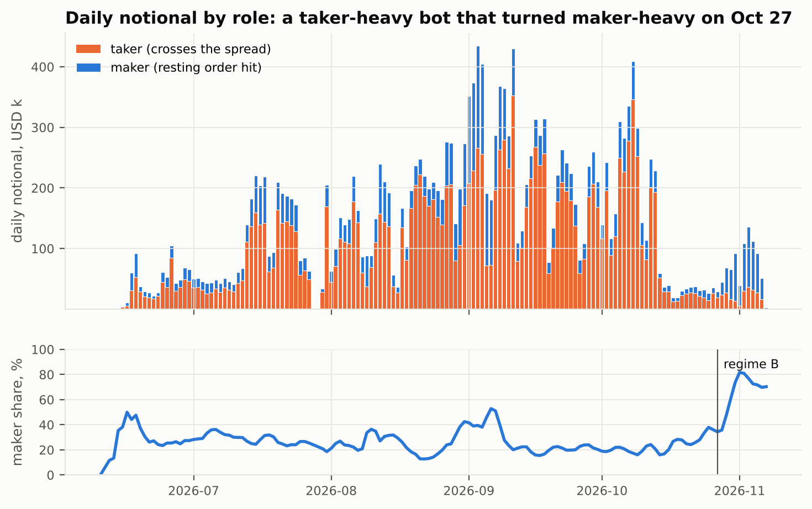
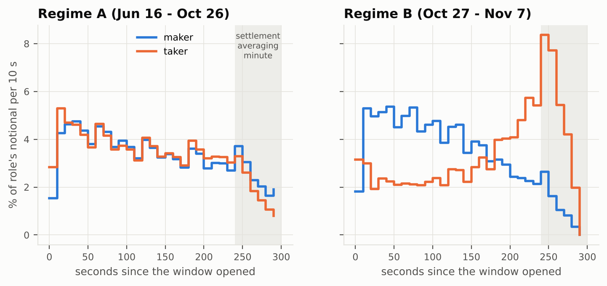
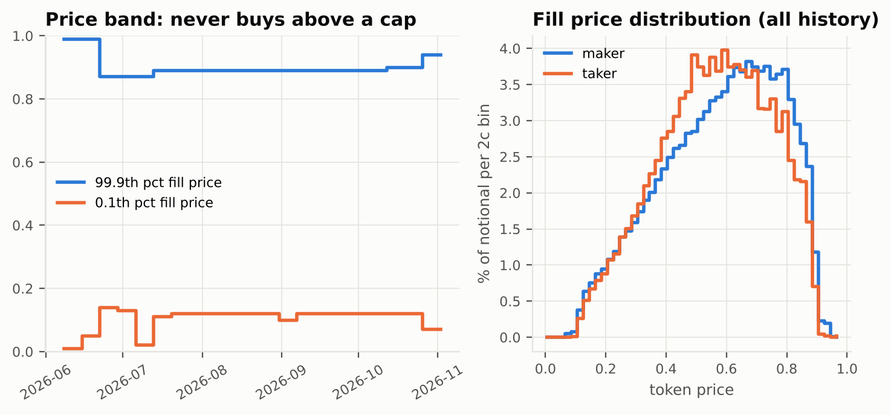
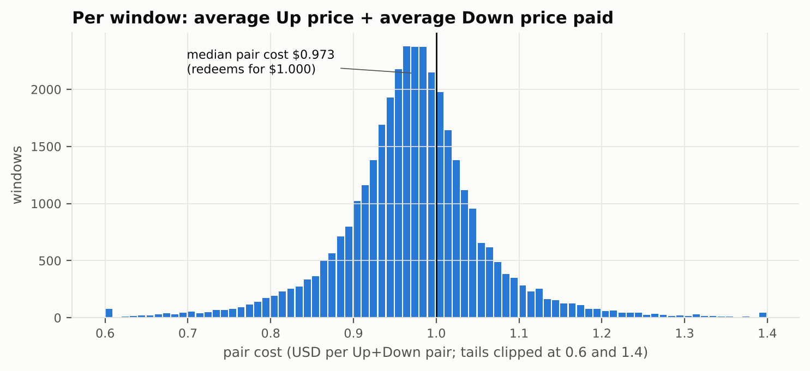
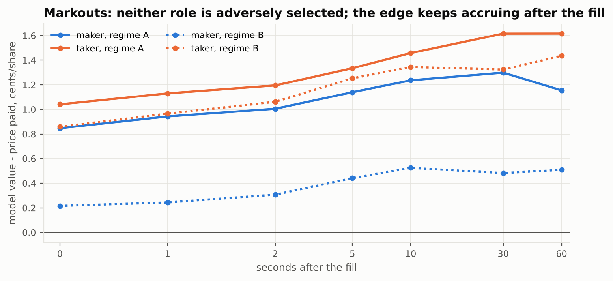
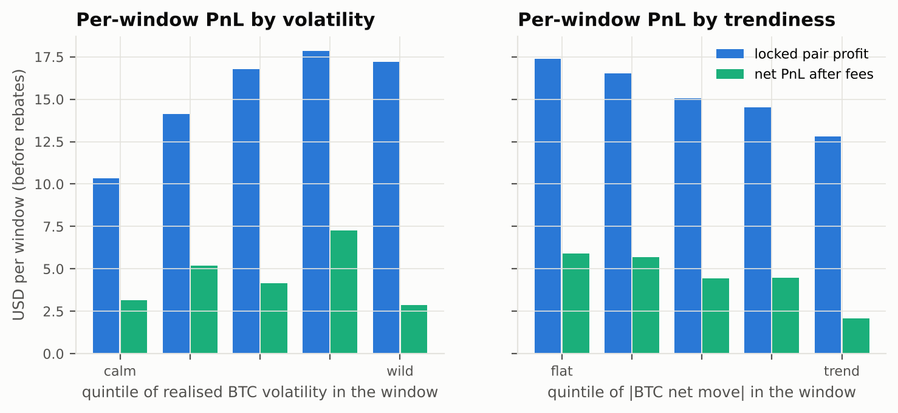

# Reverse-engineering x-MoneyForWhiskas — the 5-minute BTC Up/Down bot on Polymarket

*Data as of 2026-11-07 02:00 UTC. Everything here is rebuilt from public data (Polymarket Data API v2,
Gamma, CLOB websocket, Binance) by the code in this repo; numbers regenerate with `python -m whiskas.report`.*

## TL;DR

`x-MoneyForWhiskas` (proxy wallet `0x3048d65321be3497164cdfc2996f94f98a2e7537`, pseudonym *Flashy-Gold*,
joined 2026-06-08) is a fully automated, **buy-only, two-sided liquidity bot** on Polymarket's
**"Bitcoin Up or Down – 5 minute"** markets. In five months it did **1.63M fills, $21.2M notional**
(98.9% of it in BTC 5-minute windows, 37,647 windows) and made **$414k all-in** from a deposited
bankroll of only **$12.9k**.

How it works, in one paragraph: inside each live 5-minute window it **buys both outcome tokens**
(Up and Down) — never sells, never merges — so on the shared order book it is simultaneously bidding
and offering. It **anchors on a fair value of P(Up)** derived from the BTC price versus the window's
TWAP strike, **joins the best bid** on both tokens with **fixed-size clips** (a ladder of 30-share
orders one cent apart in the current version), and **crosses the spread with fixed-size orders** when
an offer is cheap enough to pay the taker fee. Matched Up+Down pairs are held to settlement, where
each pair pays exactly $1: across all windows the bot paid a **median $0.973 per pair**. The
leftover (unpaired) inventory is small and close to delta-neutral. Purchases are confined to a
**price band** (0.12–0.89 for most of its life, 0.07–0.94 now).

Where the money comes from:

| | USD |
|---|---:|
| Gross trading PnL before fees (payouts − purchase cost) | **+643k** |
| Taker fees paid (`fee = shares × 0.07 × p × (1−p)`) | **−472k** |
| Taker rebates (Obsidian tier: 50% of taker fees back) | **+206k** |
| Maker rebates (20% of fees, fee-curve weighted) + liquidity rewards | **+36k** |
| **All-in PnL** | **+414k** |

Taking liquidity earned about as much gross edge as it paid in fees: **the 50% taker rebate is half
the bot's profit**. On 2026-10-27 it switched from taker-heavy (75% of notional taken) to maker-heavy
(71% of notional made) — the version running today is the "market making bot".



---

## 1. The market it trades

| Property | Value (from Gamma market metadata) |
|---|---|
| Series | `btc-up-or-down-5m`, slug `btc-updown-5m-<window start epoch>` — 288 windows/day |
| Listing | each window is listed ~24 h before it opens; only ~6% of volume trades before the open |
| Settlement (since 2026-08-14) | **Up iff Chainlink BTC/USD TWAP-60 at the end ≥ TWAP-60 at the start** (`btc-5m-twap-60`) |
| Earlier rules | spot-vs-spot until 08-06, TWAP-30 from 08-07 to 08-13 |
| Fees | `crypto_fees_v2`: taker pays `0.07·p·(1−p)` per share (1.75¢ at 50¢); makers pay nothing |
| Rebates | 20% of taker fees go to makers (fee-curve weighted); taker tiers refund up to 50% |
| Tick / min size | 0.01 (0.001 near the extremes) / 5 shares |
| Book | **one shared book per window**: a BUY Down at q is the same liquidity as a SELL Up at 1−q (best bid Up + best ask Down = 1.00 in every live snapshot) |
| Activity | ≈ $22–24k notional per window in the live 5 minutes (sampled tapes, 300 windows) |

**Settlement rule, verified.** Testing candidate rules against 37,647 resolved windows with Binance
1-second data: spot-vs-spot fits the June–August windows (96.2%), TWAP60-vs-TWAP60 fits the current
windows (97.4% with a 1 s Chainlink lag; the residual is Binance≠Chainlink noise on close calls).
Note that **polymarket.com's "price to beat" (`/api/crypto/crypto-price` `openPrice`) is the Chainlink
*spot* price at the open, not the TWAP strike**: comparing its `closePrice` to `openPrice` disagrees
with the on-chain resolution in **12% of windows** (verified against `/v2/resolutions` payouts and the
wallet's own redemptions). The bot does not appear to exploit this specifically (its PnL is not
concentrated in those windows), but any model that prices off the displayed strike is wrong 1 time in 8.

**Fair value.** `whiskas/fairvalue.py` prices the token as a digital on a TWAP: with the strike K
known at the open, the final average A has mean S<sub>t</sub> and variance
σ²S²[(240−t)+20] before the averaging minute, and a shrinking (300−t)³/(3·60²) inside it, plus 1 bp
of feed-basis noise. σ is an EWMA (half-life 10 min) of overlapping 5 s returns ×1.1. Calibrated on
1.1M (window, second) points: log-loss 0.448 vs 0.693 for a coin flip, reliability curve near the
diagonal (0.15→0.14, 0.75→0.78, 0.97→0.96).

## 2. What the bot does — the reconstructed rules

```
every live window (t = seconds since open, 0..300), on every BTC tick / book update:
    fv_up   = P(TWAP60(end) >= TWAP60(start) | BTC now)        # TWAP-aware digital, sec. 1
    skew    = k · (shares_Up − shares_Down)                     # soft inventory balancing (modelled:
                                                                #  54% of taker notional completes a pair,
                                                                #  median final imbalance 12% of shares)
    fv[Up]  = fv_up − skew ;  fv[Down] = 1 − fv_up + skew

    # taker leg — fixed clip, FAK
    for token in (Up, Down):
        ask = best offer for token (Down offers = 1 − Up bids)
        if P_MIN <= ask <= P_MAX and ask + fee(ask)·(1 − 0.50) + TAKER_EDGE <= fv[token]:
            BUY token, size = CLIP_TAKE, limit = highest price still satisfying the inequality

    # maker leg — join the touch, never improve it
    if QUOTE_START <= t <= QUOTE_STOP:
        top = min(floor_tick(fv[token] − MAKER_EDGE), best bid for token)
        rest BUY orders of CLIP_MAKE shares at top, top−1¢, … (LEVELS deep), inside [P_MIN, P_MAX]
        cancel/replace levels as fv and the touch move (orders live ~4 s on median)
    stop buying a token when window spend or Up/Down imbalance limits are hit
never sell, never merge; at settlement every Up+Down pair redeems for $1
```

| Parameter | Regime A (Jun 16 – Oct 26) | Regime B (Oct 27 – now) | Evidence |
|---|---|---|---|
| Active time in window | 0–300 s, flat profile | maker fills from ~10 s, fading after 240 s; takes late (median 196 s) | fig. 3 |
| P_MIN – P_MAX | 0.12 – 0.89 (0.87 in late June, 0.90 mid-Oct) | 0.07 – 0.94 | fig. 4 |
| CLIP_TAKE (shares) | 30 (Jun) → 90/45 (Jul) → 50 (Sep) → 60 (Oct) | 30 | modal taker fill sizes |
| CLIP_MAKE / LEVELS | 30–60 shares | 30 shares × ≥4 levels, 1¢ apart | live book, level deltas |
| Maker share of notional | 25% | 71% | fig. 2 |
| Window spend (median / p99) | $113 (Jun) → $719 / $3.7k (Sep) | $232 / $1.2k | per-window costs |
| Up–Down imbalance after a fill (p5 / p95) | −361 / +427 shares (Sep) | −269 / +334 shares | inventory replay |

Sizes and caps change in steps, roughly monthly — they are configuration, scaled with the bankroll.

## 3. Evidence

### 3.1 Two regimes: taker-heavy, then maker-heavy



Role labels come from pulling every fill twice (`/v2/trades?taker_only=false` and `=true`). The
labelling reproduces the maker rebates the wallet actually received: 20% × the fee-equivalent of its
maker fills = $32.8k vs $33.4k paid.

### 3.2 When in the window it trades



No fill ever happens before a window opens, even though books exist for 24 h. In regime B the maker
ladder works the first four minutes and the taker leg concentrates in the final 100 s, when the TWAP
starts locking in the outcome and stale quotes are most valuable.

### 3.3 Price band



The weekly 99.9th-percentile purchase price is a step function (0.87 → 0.89 → 0.90 → 0.94) and the
floor mirrors it — a symmetric "only buy tokens priced in [1 − cap, cap]" rule.

### 3.4 Pairs, not bets



95% of windows end with both tokens held. Over all windows the riskless pair profit
(min(Up, Down) shares × (1 − avg Up price − avg Down price)) is **$574k**; the unpaired residual adds
**$67k**; taker fees take **$471k** (before rebates). The residual side wins 50.3% of the time at a
median price of 0.47 — there is no meaningful directional bet. The bot **never merges** (zero MERGE
rows in its activity) — it holds to settlement and redeems (76,865 redemptions, $21.85M paid out).

### 3.5 Edge per fill



| | realised edge (won − price) | taker fee | net |
|---|---:|---:|---:|
| Regime A maker | **+1.17¢**/share | 0 | +1.17¢ + rebate |
| Regime A taker | **+1.62¢**/share | 1.48¢ | +0.14¢ before, +0.88¢ after the 50% rebate |
| Regime B maker | +0.38¢/share | 0 | +0.38¢ + rebate |
| Regime B taker | +1.90¢/share | 1.49¢ | +0.41¢ before, +1.16¢ after rebate |

Both roles show **positive, rising markouts** — the maker fills are not adversely selected.

The same holds **without any fair-value model**. In 300 sampled windows with full tapes, compare the
price the bot paid with where *everyone else* traded the same token around it (VWAP of other wallets'
prints, cents):

| regime / role | 30–6 s before | 5–1 s before | **1–5 s after** | 6–30 s after |
|---|---:|---:|---:|---:|
| A / maker | +1.50 | +0.35 | **+1.16** | +1.26 |
| A / taker | +0.90 | +0.04 | **+2.02** | +1.95 |
| B / maker | −0.69 | +0.06 | +0.12 | −0.09 |
| B / taker | −0.61 | −1.37 | **+2.85** | +2.38 |

Its takes buy a token **~2¢ below where the market trades it a few seconds later** — the signature of
a faster price signal than the quotes it lifts (regime A), and of late-window momentum in regime B
(the token had already risen 1.4¢ in the previous five seconds and keeps going). Its resting bids are
hit ~1¢ below the subsequent market in regime A; in regime B they earn the spread and rebate only.

Who is on the other side: the takers who hit its quotes are a long tail of ~2,000 wallets (top five
= 15–17% of that flow, including omnibus/app wallets) — mostly uninformed flow — while the offers it
lifts come from 470–1,440 makers, many of them other bots (CrouchPredictions, hdueilqhsdn, …). The bot
is a mid-sized participant: 2.4% of taker and 0.7% of maker volume in regime-A windows, 0.35% / 1.0%
in regime B (each window trades ≈ $22–24k while live).

### 3.6 When it makes money



It deploys more capital when BTC is volatile and earns most in **choppy, mean-reverting windows**;
trending windows are its worst (a classic market-maker profile — the side it bought early keeps losing
value and the pair can only be completed at a higher cost). It runs 24/7: median 274 of 288 windows a
day, busiest 13:00–15:00 UTC.

## 4. Live observation (2026-11-07)

LIVE_SECTION

## 5. Reference implementation

`whiskas/bot/` re-implements the rules above:

* `model.py` — online TWAP-aware fair value from Chainlink (RTDS) or Binance ticks, identical to the
  batch model (tested to 1e-3).
* `strategy.py` — the pure decision function: taker leg, join-the-touch ladder, price band, inventory
  skew and window limits. `params.py` has presets for both regimes.
* `sim.py` — replays a recorded session (`python -m whiskas.live.record`) through the strategy with
  latency, book walking for takes and a queue model for resting orders, then compares simulated fills
  with the wallet's real fills in the same windows.

SIM_SECTION

It has **no order-sending code**: wiring it to the CLOB needs your own API credentials and the official
client (`polymarket-client`), and polymarket.com is not available to US persons.

## 6. Caveats

* The order book is anonymous: resting quotes are inferred from fills (which always carry the
  wallet) plus exact book-level deltas in the live recording, not observed directly.
* Fair value uses Binance as a proxy for the Chainlink stream historically (1–2 s lag, ~1 bp basis
  noise); per-fill model edges are therefore noisy — the realised (won − price) edges are model-free.
* Block timestamps trail the off-chain match by a few seconds; sub-second latency claims are only
  possible for the live session.
* Taker-rebate tiers depend on 30-day weighted volume; the 50% figure applies to the wallet's current
  Obsidian tier and was lower while it was climbing tiers in June–July.

## Reproduce

```bash
pip install -r requirements.txt
python -m whiskas.collect stats && python -m whiskas.collect activity
python -m whiskas.collect trades --role all && python -m whiskas.collect trades --role taker
python -m whiskas.collect markets && python -m whiskas.collect klines --start 1781049600
python -m whiskas.collect tapes && python -m whiskas.collect strikes
python -m whiskas.features                    # derived tables in data/
python -m whiskas.report                      # figures + reports/tables.md
python -m whiskas.live.record --minutes 75    # live session
python -m whiskas.bot.sim data/live/session_*.jsonl.gz --preset B
```
